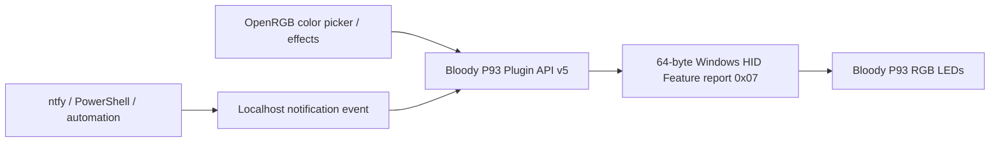

# I Turned My Mouse into a Flashing Beacon

### *Tegin hiirest vilkuri* — Bloody P93 RGB Bridge for OpenRGB

**Yes, it is a little ridiculous. That's the point.** Turn a Bloody P93 gaming mouse into a customizable notification beacon: independent HID RGB color slots, alternating yellow or red strobes, and signals from local automation.

[](https://github.com/liikane/openrgb-bloody-p93/actions/workflows/build-windows.yml)


Developed by [liikane](https://github.com/liikane) as a free, open-source **OpenRGB 1.1 Plugin API v5** extension. Not affiliated with Bloody or the OpenRGB project.

## What works

| Feature | Status |
| --- | --- |
| Detect Bloody P93 `09DA:31DE` on Windows | **Verified** |
| OpenRGB Devices → change overall mouse RGB color | **Verified on physical hardware** (10 Nov 2026) |
| Mouse buttons remain functional while changing color | **Verified by user** (10 Nov 2026) |
| 15 independently configurable HID RGB **report slots** | Implemented; exact mapping to physical LEDs still being charted |
| Alternating yellow/red “beacon” pattern in user-selected slot groups | Implemented, pending physical v0.2 test |
| Local notification commands for automation/ntfy hooks | Implemented, pending physical v0.2 test |
| No driver, firmware or button-macro changes | By design; only HID RGB feature commands are sent |
| Genesis Rhod 600 keyboard support | **Separate next project**; not implemented here |

## Quick start

1. Install [OpenRGB 1.1](https://openrgb.org/) on Windows x64 and connect a Bloody **P93**.
2. Download a Windows DLL from [GitHub Releases](https://github.com/liikane/openrgb-bloody-p93/releases). The latest prerelease and its status are specified on that page.
3. Close OpenRGB completely. Copy `OpenRGBBloodyP93Plugin.dll` into `%APPDATA%\OpenRGB\plugins\`, then restart OpenRGB.
4. In **Settings → Bloody P93**, check **Enable RGB control (experimental)**.
5. In **Devices**, select **Bloody P93 (community)**. Click a colored slot and choose a color.

The plugin is **opt-in**: it does not send any mouse lighting commands until RGB control is enabled.

## The beacon

- 15 HID slots are exposed individually. Use **Identify next LED slot** to discover which actual light responds to each slot.
- Enter the comma-separated slot numbers for groups A and B. The default is 1–7 versus 8–15; adjust them to match the *physical* left/right layout.
- Set the interval (120–2000 ms) and enable **Flashing beacon**. The initial color is yellow.
- For notification hooks, additionally enable **Local notification commands**. The plugin listens only on `127.0.0.1:45893`.

```powershell
.\Send-P93Notification.ps1 -Event ALERT    # 5 s yellow beacon
.\Send-P93Notification.ps1 -Event ERROR    # 5 s red beacon
.\Send-P93Notification.ps1 -Event SUCCESS  # 1.8 s solid green
.\Send-P93Notification.ps1 -Event STOP     # Restore OpenRGB colors
```

The included PowerShell command talks only to the **local** OpenRGB plugin. For ntfy or ChatGPT signals, configure a separate event source to invoke this command; it does not watch cloud services by itself.

## Documentation / manuaal

- [Project story: how I turned a mouse into a flashing beacon](docs/CASE_STUDY.md)
- [English user manual](docs/USER_MANUAL.md)
- [Eestikeelne kasutusjuhend](docs/KASUTUSJUHEND.md)
- [HID RGB protocol and exact commands](docs/HID_PROTOCOL.md)
- [GitHub Issues](https://github.com/liikane/openrgb-bloody-p93/issues) for requests and bug reports

## How it works



**USB:** VID `0x09DA`, PID `0x31DE`, `MI_02/COL04`, UsagePage `0xFF32`, Usage `0x0218`. Feature report ID `0x07`, 64 bytes. Static color command starts `07 03 06 02` with fifteen (R,G,B) triplets. See [protocol documentation](docs/HID_PROTOCOL.md).

## Build

The plugin is C++17 + Qt 6.8.3. Match the OpenRGB 1.1 headers and ABI, using MSVC 2022 on Windows:

```powershell
git clone https://github.com/liikane/openrgb-bloody-p93.git
cd openrgb-bloody-p93
git clone --branch release_1.1 https://github.com/CalcProgrammer1/OpenRGB.git openrgb
$env:OPENRGB_SOURCE_DIR = (Resolve-Path .\openrgb).Path
qmake OpenRGBBloodyP93Plugin.pro
nmake
```

The resulting plugin DLL is in `dist/`. [GitHub Actions](https://github.com/liikane/openrgb-bloody-p93/actions) runs C++ protocol tests and builds a Windows DLL.

## Safety and limitations

The plugin is **experimental** and initially supports only the precise Bloody P93 HID identity. Mouse firmware, saved macros, DPI and button mappings are never intentionally written. Individual *physical* LED positions and all restart combinations are being verified; do not assume HID slot #1 is leftmost until measured. The local notification port is disabled by default.

A known working v0.1.1 prerelease demonstrated that the GUI color picker changes P93 lighting and mouse buttons still work. The new multi-slot/notification features require testing before being described as hardware-verified.

Public project and source: GPL-2.0-or-later. [Issue for the eventual official OpenRGB plugin-gallery listing](https://github.com/liikane/openrgb-bloody-p93/issues/1).

## v0.2.1: Settings persist after restart

OpenRGB now remembers the **Enable RGB control** setting, the last 15 configured slot colors, beacon group A/B mappings, flash interval, and the local notification listener opt-in. The beacon **does not automatically start flashing** after restarting OpenRGB; enable it when needed. The local notification listener uses Windows Winsock (no Qt Network runtime DLL required) and is bound to loopback only.

Preferences are stored locally in the user profile with Qt QSettings (INI format). Unchecking **Enable RGB control** also saves the disabled state. The plugin re-enables control at startup only if a matching mouse is connected and the prior user preference was enabled. This release is a community preview; test against the physical P93 before declaring full compatibility.
