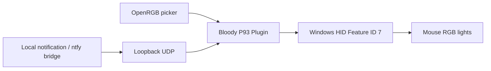

# I Turned My Mouse into a Flashing Beacon
### *Tegin hiirest vilkuri*

**Project:** [Bloody P93 RGB Bridge](https://github.com/liikane/openrgb-bloody-p93)  
**Platform:** Windows / OpenRGB 1.1  
**License:** GPL-2.0-or-later  
**Author:** [liikane](https://github.com/liikane)

## The idea

Why keep a gaming mouse quietly glowing when it can become a visible signal for automations?

A flashing mouse is deliberately playful. The useful part is a non-intrusive notification: scripts and applications can signal that a task is complete or needs attention without taking keyboard focus or displaying another modal window.

## The engineering challenge

The Bloody P93 mouse is not listed as a supported device in OpenRGB 1.1. We discovered its USB/HID interface and investigated the RGB command family. The first experiments changed the mouse to solid purple and triggered red/green flashes while its button macros remained usable.

Rather than patching OpenRGB itself, we built a standalone Plugin API v5 extension, called **Bloody P93 RGB Bridge**.

## Milestones

| Step | Evidence |
| --- | --- |
| HID hardware detection | Vendor 09DA, product 31DE; MI_02/COL04 |
| First RGB commands | Physical mouse changed color and flashed |
| OpenRGB integration | Custom virtual controller appears in Devices |
| User acceptance | 10 Nov 2026: OpenRGB changes mouse color; mouse buttons still work |
| Multi-slot and beacon edition | Source implemented; physical mapping and notification acceptance testing pending |

## The fun part

The next step is a **yellow left/right flasher** like a miniature vehicle beacon, with adjustable interval and custom slot groups. A local automation can send `ALERT`, `ERROR`, or `SUCCESS` to the plugin, causing yellow/red flashes or a green completion signal.

No need to interrupt the current document or capture keyboard focus. The product is deliberately amusing, but the underlying Windows HID integration, OpenRGB plugin, and test pipeline are real.

## Responsible engineering

The plugin only targets an exact HID identity and known RGB reports. It does not rewrite the mouse firmware or button macros. Controls are opt-in, and the local UDP listener is disabled by default.

## Documentation and source

- [Project and source code](../README.md)
- [English user manual](USER_MANUAL.md)
- [Eestikeelne kasutusjuhend](KASUTUSJUHEND.md)
- [Detailed HID protocol and command bytes](HID_PROTOCOL.md)
- [Releases](https://github.com/liikane/openrgb-bloody-p93/releases)
- [Hardware acceptance and remaining tasks](https://github.com/liikane/openrgb-bloody-p93/issues)

**Next device:** Genesis Rhod 600 RGB keyboard — researched separately, with no unverified output commands sent.
