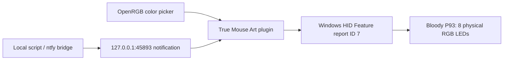

# True Mouse Art

**Bloody P93 mouse OpenRGB Plugin**

*I Turned My Mouse into a Flashing Beacon!*

### A mouse that refuses to stay quiet

Some people build a dashboard to track a computer's tasks. Some have notification sounds, pop-ups, or a carefully arranged taskbar. We happened to have a Bloody P93 gaming mouse with eight RGB LEDs — and an extremely important question: *could the mouse itself tell us when something happens?*

This began as a bit of fun. We were debugging a keyboard RGB interface, noticed the mouse was programmable over Windows HID, and wondered whether it could flash like a tiny beacon. Within a few tests, the mouse turned purple on command. Then red. Then green. The practical joke turned into a real OpenRGB plugin.

It's not going to direct traffic, but it's surprisingly good at asking for attention.

## The challenge: unknown mouse meets open software

OpenRGB 1.1 already supports several Bloody models, but not the P93. Its USB ID is `09DA:31DE`; on Windows its vendor HID interface is `MI_02/COL04`. We verified that the relevant report is a **64-byte HID Feature report** with Report ID **7**, and that `07 03 06 02` is the color-control command.

The report has fifteen RGB triplet fields. That initially looked like fifteen LEDs. The real mouse, however, has **only eight physical LEDs**. With the device owner's observations, we mapped the visible LEDs to slots **1–8**, hid the remaining fields in the interface, and documented each channel's actual byte offsets.

This is now an openly documented [LED-to-HID byte map](LED_MAP.md), not an opaque box of guessed numbers.

## The tiny beacon

A single blinking color wasn't enough. Our first useful pattern now alternates **LED 1 + 4** (the prominent wheel and area immediately behind the wheel) against **LED 2 + 3 + 5 + 6 + 7 + 8** (the rest, including the logo). These groups flash in yellow or red, with a configurable interval.

The logo, incidentally, lights up through LEDs **7 and 8 together**. Nobody promised that the logo was the most straightforward part of the project.

## The technical architecture

- **Qt 6 / C++17 / OpenRGB Plugin API v5**: adds a virtual P93 RGB controller without modifying OpenRGB itself.
- **Windows HID**: eight separately configurable LED colors, sent using only known RGB commands.
- **Windows Winsock**: optional loopback-only notifications for `ALERT`, `ERROR`, `SUCCESS`, and `STOP`.
- **Saved user preferences**: RGB enablement, colors, groups and interval survive OpenRGB restarts.
- **GitHub Actions**: builds and runs C++ HID packet tests without requiring a complete C++ environment on the user’s computer.

No firmware modification, button remapping, custom USB driver, keylogging, or background internet traffic is involved.

## Real hardware, real tests

On a physical P93, previous versions successfully changed RGB colors through OpenRGB and left the mouse buttons usable. We verified the output of the alternating beacon and green completion signal by sampling the HID feature reports. In a separate owner test, the eight physical LED positions and their shared logo behavior were identified.

The new default **1+4 versus the remaining six** pattern and updated eight-control interface are tracked as a separately verified release; see [validation notes](VALIDATION.md) for the build and hardware evidence.

## Documentation worth sharing

This project is deliberately easy to inspect and reproduce. We're publishing the [English manual](USER_MANUAL.md), [Estonian manual](KASUTUSJUHEND.md), [LED location map](LED_MAP.md), [exact command protocol](HID_PROTOCOL.md), test results, and the sources under GPL-2.0-or-later.

**Project:** [liikane/openrgb-bloody-p93](https://github.com/liikane/openrgb-bloody-p93)

**Releases:** [GitHub](https://github.com/liikane/openrgb-bloody-p93/releases)

**Maintainer:** [liikane](https://github.com/liikane)

*And then there is the Genesis Rhod 600 keyboard. Eight lights are fun. A keyboard with a few more possibilities might be even more interesting.*
