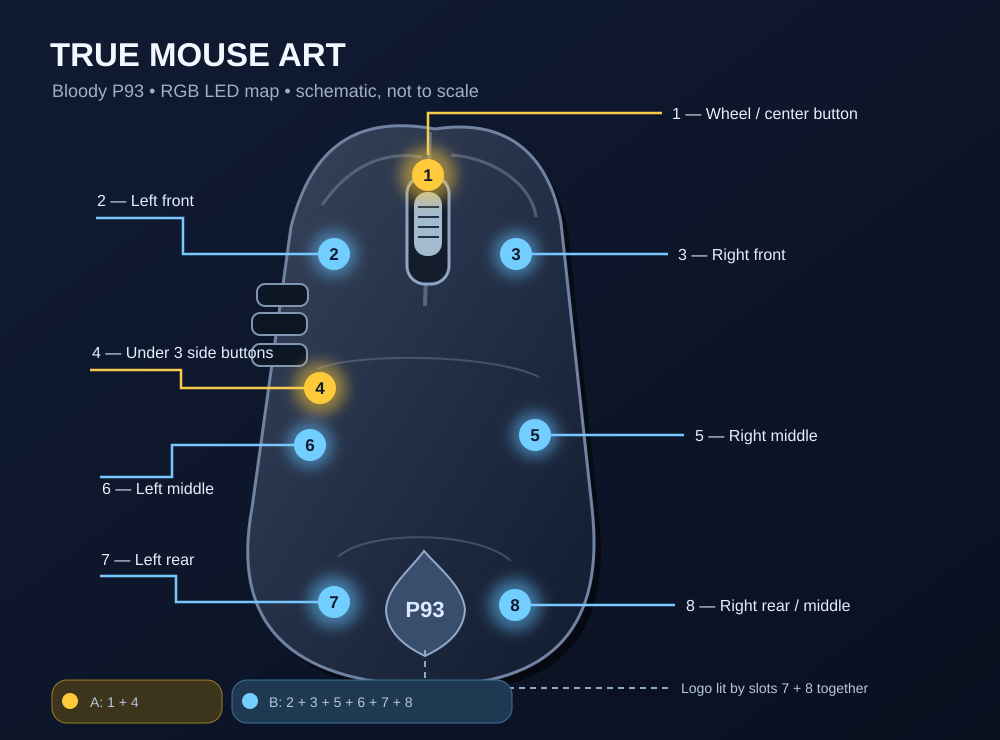

# Tegin hiirest vilkuri — kasutusjuhend

**Bloody P93 hiire OpenRGB plugin**

*Arvuti annab hiire LED-idega märku, kui töö on valmis või midagi vajab tähelepanu.*

**English project name:** True Mouse Art / Bloody P93 mouse OpenRGB Plugin / *I Turned My Mouse into a Flashing Beacon!*

See vabavaraline plugin võimaldab juhtida hiire kaheksat valgustit eraldi, panna need vaheldumisi vilkuma ja reageerida arvutist saadetud teavitustele. Hiirenuppude määranguid, ekraanipildimakrot, DPI-d ega püsivara see ei muuda.

## 1. Nõuded ja paigaldamine

- Windows 10/11, OpenRGB **1.1**, hiir **Bloody P93** (USB `09DA:31DE`).
- Laadi [GitHubi Releases-lehelt](https://github.com/liikane/openrgb-bloody-p93/releases) uusim sobiv testitud või selgelt märgistatud katseversioon `OpenRGBBloodyP93Plugin.dll`.
- Sulge OpenRGB, ka süsteemisalvest, ja kopeeri DLL kausta `%APPDATA%\OpenRGB\plugins\`. Vajaduse korral loo kaust. Hoia eelmine DLL alles, et saaksid selle vajadusel taastada.
- Käivita OpenRGB. Ava **Settings → Bloody P93** ja märgi **Enable RGB control**.
- Vali **Devices → Bloody P93 (community)**: seal kuvatakse **kaheksa** LED-i.

Plugin ei vaja eraldi USB-draiverit ega PawnIO-d. Windowsi Smart App Control võib allkirjastamata DLL-i blokeerida; kontrolli esmalt faili päritolu ja kontrollsummat. Üldiste Windowsi turvameetmete väljalülitamine pole plugina kasutamise eeltingimus.

## 2. Hiire LED-ide skeem



Skeem näitab LED-ide asukohti hiire ülaltvaates; see pole täpne tootjajoonis. **Kõige silmatorkavam LED on nr 1 ehk rullik.** Logo valgustavad **7 ja 8 koos**.

### LED = SLOT = HID bait

HID-käsk sisaldab 64 baiti; LED-i värv on kolmik **R, G, B** alltoodud *nullist algava* baidiofssetiga.

| LED | SLOT | Asukoht | HID R | HID G | HID B |
|---:|---:|---|---:|---:|---:|
| **1** | 1 | Keskmine klahv / rullik | 8 | 9 | 10 |
| **2** | 2 | Vasak ees | 11 | 12 | 13 |
| **3** | 3 | Parem ees | 14 | 15 | 16 |
| **4** | 4 | Kolme lisanupu all keskel | 17 | 18 | 19 |
| **5** | 5 | Parem keskel | 20 | 21 | 22 |
| **6** | 6 | Vasak keskel | 23 | 24 | 25 |
| **7** | 7 | Vasak taga; ühtlasi logo | 26 | 27 | 28 |
| **8** | 8 | Parem taga ja keskel; ühtlasi logo | 29 | 30 | 31 |

**Tähtis:** kuigi HID-aruandes on 15 RGB-värvikohta, on P93-l ainult **8 füüsilist LED-i**. Kohad 9–15 jäetakse välja lülitatuks ega ole OpenRGB-s nähtavad. Täpne tabel ja [skeem](LED_MAP.md).

## 3. Värvide muutmine

Ava **Devices**, vali hiir ning klõpsa soovitud LED-il (1–8). Vali värvirattalt värv või sisesta Hex-väljale väärtus. Vajaduse korral vajuta **Apply Colors To Selection**.

Näited: lilla `A000FF`, roheline `00FF00`, punane `FF0000`, kollane `FFD200`.

Seaded salvestatakse kasutajaprofiili. Viimati valitud kaheksa värvi ja RGB-juhtimise sisselülitamine taastatakse OpenRGB järgmisel käivitamisel. **Saving Not Supported** OpenRGB seadme all tähendab, et hiire püsivara profiile ei kirjutata; tarkvaralisi profiile võib kasutada.

## 4. Vilkur

Plugin ei piirdu kõigi tulede korraga sisse/välja lülitamisega. Selle algne kahefaasiline muster on:

| Faas | Kollaselt põlevad LED-id | Väljas |
|---|---|---|
| **A** | **1 + 4** – rullik ja lisanupud | 2, 3, 5, 6, 7, 8 |
| **B** | **2 + 3 + 5 + 6 + 7 + 8** – ülejäänud, sh logo | 1, 4 |

Ava **Settings → Bloody P93**. Seal saad muuta gruppide numbreid ja **Beacon interval** vahemikus 120–2000 ms, seejärel märkida **Flashing beacon**. Sisselülitatud vilkur vaheldub kahe grupi vahel. Lõpetamiseks eemalda linnuke või vajuta **Restore selected OpenRGB colors**.

See on esialgu rulliku/lisanupupiirkonna ja ülejäänud tulede *vahelduv vilkumine*, mitte kahe külje täpne vasak-parem režiim. Vilkur **ei hakka pärast programmi taaskäivitust automaatselt vilkuma**.

## 5. Teavitused ja kiirkäsud

Kui märgid ka **Enable local notification commands**, kuulab plugin sama arvuti aadressil `127.0.0.1:45893`. Väliseid internetiühendusi see ei ava.

Laadi projekt GitHubist alla ja käivita selle kaustas:

```powershell
.\Send-P93Notification.ps1 -Event ALERT
.\Send-P93Notification.ps1 -Event ERROR
.\Send-P93Notification.ps1 -Event SUCCESS
.\Send-P93Notification.ps1 -Event STOP
```

| Käsk | Mõju |
|---|---|
| `ALERT` / `NOTICE` | Kollane kahe grupi vilkumine 5 sekundit |
| `ERROR` | Punane kahe grupi vilkumine 5 sekundit |
| `SUCCESS` | Kõik kaheksa LED-i roheliseks 1,8 sekundiks |
| `STOP` | Peatab efekti ja taastab OpenRGB valitud värvid |

Näiteks saab sinu kohalik ntfy-sõnumit töötlev skript käivitada `-Event ALERT`. Plugin ise **ei ühendu ntfy ega ChatGPT-ga**: selleks tuleb sündmuse tuvastus ja käsu väljakutse eraldi seadistada.

## 6. Tõrkeotsing

| Probleem | Lahendus |
|---|---|
| Plugin ei ilmu OpenRGB-s | Veendu DLL-i asukohas ja taaskäivita OpenRGB täielikult |
| Hiir puudub Devices nimekirjas | Kasuta õiget P93 mudelit; vajuta **Retry device detection** |
| Värvid ei muutu | Luba **Enable RGB control**, vali LED ja rakenda värv |
| Värv muutub ise tagasi | Teine RGB-tarkvara võib samaaegselt valgustust juhtida |
| PawnIO hoiatus | P93 puhul pole PawnIO vajalik |
| Smart App Control blokeerib | Kontrolli väljalaset ja allkirjastamist; pole üksiku DLL-i erandit |
| Teavitused ei tööta | Kontrolli linnukest ja et port 45893 oleks vaba |
| LED 9–15 puuduvad | See on õige: need ei vasta füüsilistele P93 LED-idele |
| Hiir ei reageeri | Sule OpenRGB, ühenda hiir uuesti ja taasta vajadusel varasem pluginaversioon |

Logid asuvad `%APPDATA%\OpenRGB\logs\`. Ära avalda tooreid USB-liikluse salvestusi, sest need võivad sisaldada teiste seadmete andmeid.

## 7. Eemaldamine ja varasema valguse taastamine

Sulge OpenRGB, kustuta `%APPDATA%\OpenRGB\plugins\OpenRGBBloodyP93Plugin.dll` ja käivita OpenRGB uuesti. Soovi korral taasta salvestatud valgusseadistus Bloody WorkShop 8 programmis. Plugin ei muuda hiire nuppude makrosid.

## 8. Tehniline ja arendusinfo

Tootjapõhine HID `VID_09DA/PID_31DE`, `MI_02/COL04`, `UsagePage=FF32`, `Usage=0218`. `HidD_SetFeature` saadab Report ID `07` ja 64-baidise RGB-käsu `07 03 06 02`; füüsiliste LED-ide värvibaitide ofsetid on **8–31**. Täpsemalt: [HID käsud](HID_PROTOCOL.md) ja [testid](VALIDATION.md).

Lähtekood: [liikane/openrgb-bloody-p93](https://github.com/liikane/openrgb-bloody-p93), litsents GPL-2.0-or-later. Projekt pole Bloody ega OpenRGB ametlik toode.
