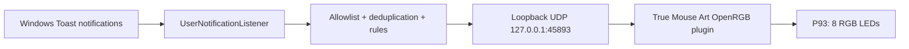

# Windows notification bridge / Windowsi teavituste sild

## Purpose

The **True Mouse Art** plugin already accepts small event commands locally and changes Bloody P93 RGB lighting. It **does not** read the Windows notification center. A **separate, opt-in, open-source notification bridge** is preferable to adding broad Windows notification permissions to a hardware-control plugin.

The bridge would observe **only user-selected applications** and forward **only event type** to the existing local plugin on `127.0.0.1:45893`. It must not transmit notification contents over the internet, store messages or introduce keyboard hooks.

## Recommended design: separate lightweight Windows tray app

Microsoft's documented API: [UserNotificationListener](https://learn.microsoft.com/en-us/windows/apps/develop/notifications/app-notifications/notification-listener).

### What it needs

1. A **packaged Windows application** with the `userNotificationListener` capability declared in the app package manifest, or another supported application identity. A plain unpackaged executable **may not receive notification events reliably** — see [Windows App SDK issue #6172](https://github.com/microsoft/WindowsAppSDK/issues/6172).
2. The user's **explicit permission** granted by `UserNotificationListener.Current.RequestAccessAsync()` from the UI thread.
3. An explicit **app allowlist**: e.g. Windows Security, Outlook, ntfy, a chosen local automation program. Default is **no apps selected**.
4. Event handling: `NotificationChanged` or the supported background trigger, plus `GetNotificationsAsync(NotificationKinds.Toast)` for app identities and notification IDs. Only newly added items are acted on; old notifications are not replayed after app restart.
5. Local classifications, without storing content: `ERROR` -> `P93:ERROR`, `WARNING` -> `P93:ALERT`, `COMPLETED` -> `P93:SUCCESS`. Ordinary unclassified notices may be ignored or mapped to `P93:NOTICE`.
6. A privacy-first tray UI with **Pause**, **Stop**, **Allowed apps**, and **Test red/green/yellow**. Prevent repeat signals, limit how many times one notification triggers the mouse, and respect user-specified quiet hours.
7. An optional toggle to start only when the user logs in; no Windows service and no cloud account.

### Optional fast path for specific programs

If a program **already runs a script** when work completes, it can use `Send-P93Notification.ps1` directly. This is more reliable and simpler than inspecting Windows notifications. Examples include PowerShell automation, build scripts, agent wrappers, or an existing ntfy subscriber. Only use the full notification listener when the program does not have a native hook.

### Existing project for comparison

[WinToastRelay](https://github.com/RavelloH/WinToastRelay) implements a Windows notification listener forwarding messages to HTTP webhooks. It is useful for reviewing Windows notification API usage, but sending complete notifications to remote webhooks is not appropriate for True Mouse Art by default. The P93 plugin expects a minimal **UDP event code**, not an HTTP webhook or full notification text. It is possible to adapt or build a separate bridge without depending on a paid service.

### Security considerations

Notifications may contain personal email subjects, names, calendar details, one-time passwords, and other secrets. The proposed bridge should read only the app identity and notification metadata required for locally configured rules, avoid persistent logs, never forward raw text by default, and support disabling access at any time. Windows permission must be requested from the person using the computer; it cannot be granted silently by the plugin.

Users must not assume all Windows events appear as Toast notifications (some are native dialogs, tray changes, and application-only alerts). ChatGPT web completion is **not automatically available** through the notification API unless a separate desktop application emits a Windows Toast event.

## Current status

- [x] P93 plugin supports opt-in local commands `P93:ALERT`, `P93:NOTICE`, `P93:ERROR`, `P93:SUCCESS`, `P93:STOP`.
- [x] Standalone PowerShell sender available in repository.
- [x] Bridge architecture and privacy constraints documented.
- [ ] Build and test separate Windows tray bridge with supported app identity/manifest.
- [ ] Implement Windows notification access permission and allowlist UI.
- [ ] Verify notification deduplication, filtering and classification on Windows 11.
- [ ] Demonstrate end-to-end Windows Toast -> local P93 RGB effect.

No standalone listener has yet been installed or enabled on LAURIDELL.
